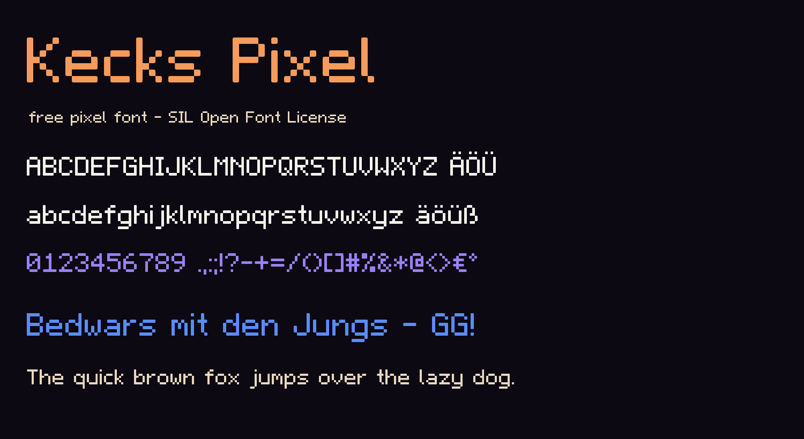

# Kecks Pixel

**A free pixel font with soft-rounded corners – for games, thumbnails, Minecraft edits and retro designs.**
Kostenlose Pixelschrift mit leicht abgerundeten Pixeln – für Games, Thumbnails, Minecraft-Edits und Retro-Designs.



**Try it online:** https://kecksKruemmel.github.io/kecks-pixel/

## Download

Get the ZIP from [Releases](https://github.com/KecksKruemmel/kecks-pixel/releases/latest) or download `out/KecksPixel-Regular.ttf` directly.
Install: double-click the `.ttf` and press **Install**.

Sharpest at sizes in steps of 10 px (10, 20, 30, 40 …) – one font pixel is exactly a tenth of the font size.

## License

**SIL Open Font License 1.1** (see [OFL.txt](OFL.txt)).

- ✅ Free for personal **and commercial** use (videos, thumbnails, logos, games, apps, websites, print)
- ✅ Embed, modify and redistribute
- ❌ Don't sell the font file on its own

Credit is appreciated but not required: *Font: Kecks Pixel by KecksKruemmel*

## Character set

`A–Z a–z Ä Ö Ü ä ö ü ß 0–9 . , : ; ! ? - _ + = / \ ( ) [ ] ' " # % & * @ < > ^ | € °`

## Build

```
python build.py
```

Requires Python with `fontTools` and `Pillow`. Every glyph is a small pixel grid in `glyphs.py`.
